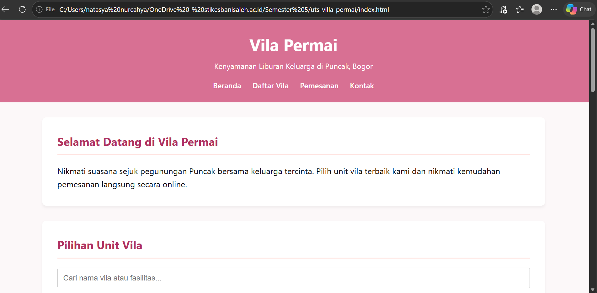
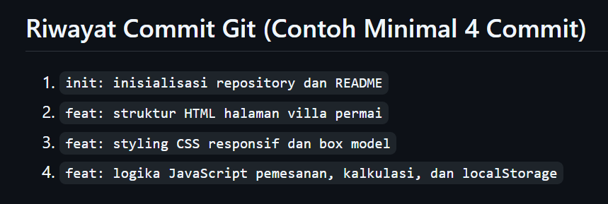

# Aplikasi Pemesanan Vila Permai - Ujian Tengah Semester Teknologi Web

* **Nama Mahasiswa:** Natasya Nurcahya
* **Nomor Induk Mahasiswa (NIM):** 24011130482
* **Program Studi / Kelas:** D3 Manajemen Informatika / MI5BM
* **Mata Kuliah:** Teknologi Web 

## Cara Menjalankan Halaman
1. Unduh atau clone repository ini ke komputer lokal Anda.
2. Pastikan file `index.html`, `style.css`, dan `script.js` berada di dalam satu folder yang sama.
3. Buka file `index.html` menggunakan browser modern (Google Chrome, Microsoft Edge, atau Mozilla Firefox).

## Daftar Fitur
*Struktur HTML5 semantik lengkap (`header`, `nav`, `main`, `section`, `article`, `footer`).
*Styling CSS eksternal menggunakan sistem *box model* dan 2 breakpoint responsif (`max-width: 768px` & `max-width: 480px`).
*Perenderan data vila dinamis menggunakan `createElement` dan `appendChild`.
*Fitur pencarian/filter unit vila secara real-time.
Perhitungan total biaya otomatis berdasarkan durasi malam dan harga satuan.
Validasi input formulir interaktif berbahasa Indonesia serta penanganan error dengan `try...catch`.
Penyimpanan riwayat pesanan menggunakan `localStorage`.

# Tangkapan Layar
# Halaman web saat dijalankan di browser, 

# Tampilan responsif dalam mobile view

# Riwayat commit pada GitHub

